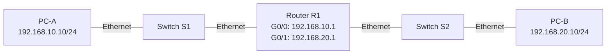

# Lab 01: Basic IPv4 Routing

## 1. Overview

This lab demonstrates how to connect two separate IPv4 networks using a Cisco router and two Layer 2 switches.

Two end devices will communicate across different IP subnets through a router. The lab introduces IP addressing, subnet masks, default gateways, router interfaces, directly connected routes, and connectivity troubleshooting.

**Status:** In progress  
**Difficulty:** Beginner  
**Platform:** Cisco Packet Tracer  
**Router:** Cisco 2911 or a compatible router with two Ethernet interfaces  
**Switches:** Cisco 2960 or compatible Layer 2 switches

## 2. Learning Objectives

By completing this lab, you should be able to:

- Identify the components of a simple routed network.
- Assign IPv4 addresses and subnet masks to end devices.
- Configure router interfaces using Cisco IOS-style commands.
- Explain the role of a default gateway.
- Verify interface status and directly connected routes.
- Test end-to-end connectivity.
- Troubleshoot common Layer 1, Layer 2, and Layer 3 connectivity problems.

## 3. Network Topology



### Physical Connections

| Device A | Interface A | Device B | Interface B |
|---|---|---|---|
| PC-A | FastEthernet0 | S1 | FastEthernet0/1 |
| S1 | FastEthernet0/24 | R1 | GigabitEthernet0/0 |
| R1 | GigabitEthernet0/1 | S2 | FastEthernet0/24 |
| S2 | FastEthernet0/1 | PC-B | FastEthernet0 |

Interface names may vary with the selected simulator device.

## 4. IP Addressing Plan

| Device | Interface | IPv4 Address | Subnet Mask | Default Gateway |
|---|---|---|---|---|
| PC-A | FastEthernet0 | 192.168.10.10 | 255.255.255.0 | 192.168.10.1 |
| R1 | GigabitEthernet0/0 | 192.168.10.1 | 255.255.255.0 | N/A |
| R1 | GigabitEthernet0/1 | 192.168.20.1 | 255.255.255.0 | N/A |
| PC-B | FastEthernet0 | 192.168.20.10 | 255.255.255.0 | 192.168.20.1 |

The switches operate as Layer 2 devices in this lab. Management IP addresses are not required for basic traffic forwarding.

### Network Summary

| Network | Network Address | Usable Host Range | Broadcast Address |
|---|---|---|---|
| LAN A | 192.168.10.0/24 | 192.168.10.1–192.168.10.254 | 192.168.10.255 |
| LAN B | 192.168.20.0/24 | 192.168.20.1–192.168.20.254 | 192.168.20.255 |

Each LAN uses a /24 prefix, equivalent to the subnet mask 255.255.255.0.

## 5. Required Configuration

### Configure PC-A

Open **Desktop → IP Configuration**.

- IPv4 address: `192.168.10.10`
- Subnet mask: `255.255.255.0`
- Default gateway: `192.168.10.1`

### Configure PC-B

Open **Desktop → IP Configuration**.

- IPv4 address: `192.168.20.10`
- Subnet mask: `255.255.255.0`
- Default gateway: `192.168.20.1`

### Configure Router R1

```text
enable
configure terminal
hostname R1
no ip domain-lookup

interface GigabitEthernet0/0
 description LAN_A_to_S1
 ip address 192.168.10.1 255.255.255.0
 no shutdown
 exit

interface GigabitEthernet0/1
 description LAN_B_to_S2
 ip address 192.168.20.1 255.255.255.0
 no shutdown
 exit

end
copy running-config startup-config
```

If the router asks for a destination filename, press Enter to accept the default.

### Configure Switch S1

```text
enable
configure terminal
hostname S1
no ip domain-lookup

interface FastEthernet0/1
 description PC_A
 switchport mode access
 no shutdown
 exit

interface FastEthernet0/24
 description R1_G0_0
 switchport mode access
 no shutdown
 exit

end
copy running-config startup-config
```

### Configure Switch S2

```text
enable
configure terminal
hostname S2
no ip domain-lookup

interface FastEthernet0/1
 description PC_B
 switchport mode access
 no shutdown
 exit

interface FastEthernet0/24
 description R1_G0_1
 switchport mode access
 no shutdown
 exit

end
copy running-config startup-config
```

## 6. Verification and Testing

### Router interface status

On R1, run:

```text
show ip interface brief
```

Expected result: both configured GigabitEthernet interfaces should eventually show `up/up`.

### Routing table

On R1, run:

```text
show ip route
```

Expected result: the routing table should include connected routes for:

- `192.168.10.0/24`
- `192.168.20.0/24`

The router installs these routes automatically when the corresponding interfaces have valid IP addresses and are operational.

### Connectivity tests

From PC-A, open **Desktop → Command Prompt** and run:

```text
ping 192.168.10.1
ping 192.168.20.1
ping 192.168.20.10
```

Repeat the end-to-end test from PC-B:

```text
ping 192.168.10.10
```

A first ping may time out while address resolution occurs. Repeat the test before treating it as a failure.

## 7. Troubleshooting Exercises

### Exercise 1: Router interface is administratively down

**Fault:** R1's GigabitEthernet0/1 has been shut down.

**Investigation:**

```text
show ip interface brief
```

**Correction:**

```text
configure terminal
interface GigabitEthernet0/1
no shutdown
end
```

Retest connectivity after the interface becomes operational.

### Exercise 2: Incorrect default gateway

**Fault:** PC-A has an incorrect default gateway.

**Symptoms:** PC-A may communicate with devices in its own subnet but cannot reach PC-B.

**Correction:** Set PC-A's default gateway to `192.168.10.1`.

### Exercise 3: Incorrect subnet mask

**Fault:** PC-B has an incorrect subnet mask.

**Investigation:** Check the IP configuration on both PCs and compare it with the addressing plan.

**Correction:** Restore the mask to `255.255.255.0`.

### Exercise 4: Incorrect interface addressing

**Fault:** R1's GigabitEthernet0/1 has an incorrect IPv4 address.

**Investigation:**

```text
show ip interface brief
show ip route
show running-config
```

**Correction:** Restore the address to `192.168.20.1 255.255.255.0`.

## 8. Completion Checklist

- [ ] All five devices are present and connected.
- [ ] PC-A and PC-B have the correct IPv4 settings.
- [ ] R1's interfaces are operational.
- [ ] Both connected routes appear in the routing table.
- [ ] PC-A can successfully ping PC-B.
- [ ] PC-B can successfully ping PC-A.
- [ ] At least one fault has been introduced and corrected.
- [ ] The Packet Tracer project has been saved.
- [ ] Actual test results and screenshots have been collected.

## 9. Evidence

Once the lab has been tested, add evidence to this folder.

Suggested evidence:

- `topology.png` — completed network topology.
- `router-interfaces.png` — output of `show ip interface brief`.
- `routing-table.png` — output of `show ip route`.
- `connectivity-tests.png` — successful ping tests.
- `troubleshooting.png` — a fault and its successful resolution.
- `lab-01-basic-ip-routing.pkt` — Packet Tracer project, if appropriate for sharing.

Only include genuine screenshots and results from your own simulator session.

## 10. Key Takeaways

A router enables communication between different IP networks. Connected routes are created when router interfaces are correctly addressed and operational. End devices need appropriate IP addresses, subnet masks, and default gateways to communicate across subnets.

This lab establishes the foundation for later work involving subnetting, VLANs, inter-VLAN routing, routing protocols, and enterprise network design.
